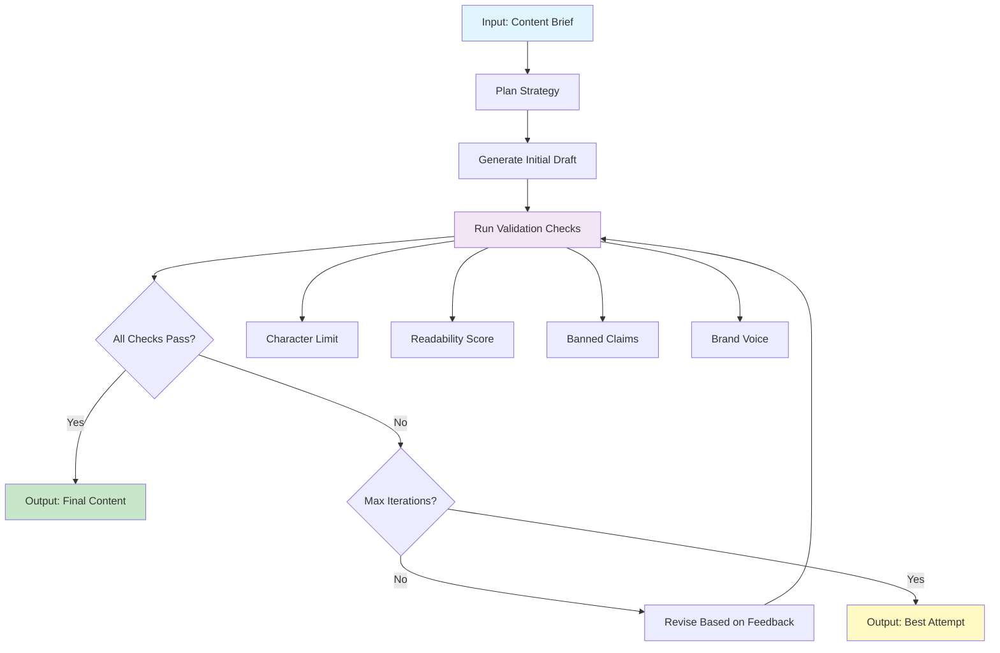

# LLM Marketing Content Agent

A portfolio-quality learning project demonstrating an agentic LLM workflow for drafting and validating marketing content. This agent takes a content brief, generates marketing copy for various channels, validates it against advertising standards and readability rules, and iteratively refines the content until quality checks pass.

**Personal, non-commercial learning project.**

## Features

- 🤖 **Agentic LLM Workflow**: Plans, drafts, validates, and revises content autonomously
- ✅ **Multi-Channel Support**: Twitter, Facebook, Instagram, LinkedIn, email subjects, ad headlines
- 📊 **Automated Validation**:
  - Character limits per channel
  - Readability scoring (Flesch-Kincaid grade level)
  - Banned claims checker (advertising standards)
  - Brand voice alignment
- 🔄 **Iterative Refinement**: Automatically revises content based on validation feedback
- 🎯 **Dual LLM Support**: 
  - OpenAI API (GPT-4o-mini) for production use
  - Deterministic mock LLM for demos and testing (no API key required)
- 📝 **Rich Output**: JSON and Markdown reports with validation details

## Architecture

### Agent Loop



### Validation Tools

The agent can call these validation tools on each draft:

1. **Character Limit Checker**: Ensures content fits channel constraints (e.g., 280 chars for Twitter)
2. **Readability Scorer**: Calculates Flesch-Kincaid grade level (targets ≤8th grade)
3. **Banned Claims Checker**: Detects unverifiable claims like:
   - "best" / "#1" / "leading" (without context)
   - "guaranteed" (without money-back context)
   - "miracle" / "instant" results
   - "proven" (without research citation)
   - Absolute claims ("always" / "never" / "100%")
4. **Brand Voice Checker**: Validates tone consistency and calls-to-action

## Installation

```bash
# Clone the repository
git clone https://github.com/yourusername/llm-marketing-agent.git
cd llm-marketing-agent

# Install dependencies
pip install -r requirements.txt
```

## Quickstart

### Using Mock LLM (No API Key Required)

Perfect for demos and testing:

```bash
# Run with a sample brief
python -m marketing_agent.cli --brief examples/coffee_brand.json --mock

# Generate for multiple channels
python -m marketing_agent.cli \
  --brief examples/fitness_app.json \
  --channels twitter facebook_post instagram_caption \
  --mock

# Save output to file
python -m marketing_agent.cli \
  --brief examples/meal_kit.json \
  --mock \
  --output results.md
```

### Using OpenAI API

1. Get an API key from [OpenAI Platform](https://platform.openai.com/api-keys)

2. Create a `.env` file:
```bash
cp .env.example .env
# Edit .env and add your key:
# OPENAI_API_KEY=sk-...
```

3. Run the agent:
```bash
python -m marketing_agent.cli --brief examples/coffee_brand.json
```

## Usage

### Command-Line Interface

```bash
python -m marketing_agent.cli --brief <brief.json> [options]

Options:
  --brief PATH              Path to JSON brief file (required)
  --mock                    Use mock LLM (no API key needed)
  --channels CHANNEL [...]  Additional channels to generate for
  --max-iterations N        Max revision iterations (default: 3)
  --model MODEL            OpenAI model (default: gpt-4o-mini)
  --output PATH            Save to file (.json or .md)
  --format {json,markdown}  Output format (default: markdown)
```

### Brief Format

Create a JSON file with these fields:

```json
{
  "product": "Your product/topic name",
  "audience": "Target audience description",
  "channel": "twitter|facebook_post|instagram_caption|linkedin_post|email_subject|ad_headline",
  "tone": "casual|professional|friendly|exciting",
  "additional_context": "Optional extra details"
}
```

See `examples/` directory for complete examples using **fictional products only**.

### Programmatic Usage

```python
from marketing_agent.agent import MarketingAgent
from marketing_agent.llm import create_llm

brief = {
    "product": "PawPantry",
    "audience": "pet owners",
    "channel": "twitter",
    "tone": "casual"
}

llm = create_llm(mock=True)
agent = MarketingAgent(llm, max_iterations=3)

result = agent.run(brief)

print(f"Success: {result.success}")
for variant in result.variants:
    print(f"{variant.channel}: {variant.content}")
```

## Sample Output

### Input Brief

```json
{
  "product": "PawPantry",
  "audience": "pet owners seeking convenient premium care",
  "channel": "twitter",
  "tone": "casual",
  "additional_context": "Monthly subscription box with premium pet food, treats, and toys customized for your pet"
}
```

### Generated Output

```
🐾 Treat your furry friend right with PawPantry! Premium pet food, treats & toys 
delivered monthly. Customized for your pet's needs. 
Try it today! ✨
```

**Validation Results:**
- ✅ Character Limit: 163/280 characters
- ✅ Readability: Grade 6.2 (target: ≤8)
- ✅ Banned Claims: No issues detected
- ✅ Brand Voice: Call-to-action present, tone appropriate

## Running Tests

```bash
# Run all tests
pytest tests/ -v

# Run with coverage
pytest tests/ --cov=marketing_agent --cov-report=term-missing

# Run specific test file
pytest tests/test_validators.py -v
```

All tests run in **offline mode** using the mock LLM.

## Project Structure

```
.
├── marketing_agent/
│   ├── __init__.py
│   ├── agent.py          # Core agent logic
│   ├── llm.py           # LLM interfaces (OpenAI + Mock)
│   ├── validators.py    # Validation tools
│   └── cli.py           # Command-line interface
├── examples/
│   ├── coffee_brand.json
│   ├── fitness_app.json
│   ├── meal_kit.json
│   ├── pet_subscription.json
│   └── travel_app.json
├── tests/
│   ├── test_agent.py
│   ├── test_llm.py
│   ├── test_validators.py
│   └── test_cli.py
├── .github/
│   └── workflows/
│       └── ci.yml        # GitHub Actions CI
├── requirements.txt
├── .env.example
├── .gitignore
├── LICENSE               # MIT License
└── README.md
```

## Design Notes

### Why an Agent?

This project demonstrates an **agentic workflow** where the LLM:
1. Plans its approach based on the brief
2. Generates content drafts
3. Uses tools to evaluate its own output
4. Decides whether to revise or finalize
5. Loops until quality criteria are met

This is more sophisticated than a simple prompt → completion workflow.

### Validation Tool Design

The validation checks are **deterministic, rule-based tools** the agent can call:
- **Not** LLM-based judgments (which would be expensive and inconsistent)
- **Objective** metrics and pattern matching
- **Actionable** feedback for revision prompts

### Mock LLM for Testability

The `MockLLM` class enables:
- ✅ Tests that run without API keys or network calls
- ✅ Deterministic behavior for CI/CD
- ✅ Demos that work out-of-the-box
- ✅ Cost-free development and iteration

It generates realistic-looking marketing content using templates and structured patterns.

### Channel-Specific Constraints

Each marketing channel has different requirements:
- **Twitter**: 280 character limit, casual tone often works
- **LinkedIn**: Professional tone, longer form accepted
- **Email subject lines**: 60 chars max, must drive opens
- **Ad headlines**: 30 chars, extremely concise value prop

The agent learns these constraints and adapts accordingly.

## Limitations

- **Mock LLM**: Produces template-based content, not truly creative copy
- **Simple validation**: Rule-based checks can't evaluate true creativity or persuasiveness
- **No A/B testing data**: Can't learn from real campaign performance
- **Limited brand voice**: Heuristic checks, not trained on actual brand guidelines
- **English only**: Readability scoring works best for English content
- **No image generation**: Text-only content creation
- **No multi-variant optimization**: Doesn't compare variants quantitatively

## Future Enhancements

This is a learning project, but could be extended with:
- RAG system for brand guideline retrieval
- Multi-language support
- Image generation integration
- Learned validation models trained on high-performing campaigns
- A/B test result ingestion and learning
- Competitive analysis tools
- SEO keyword optimization
- Sentiment analysis
- Legal compliance checking for regulated industries

## Contributing

This is a personal learning project and not actively seeking contributions. Feel free to fork and adapt for your own learning!

## License

MIT License - see [LICENSE](LICENSE) file.

**Personal, non-commercial learning project.**

## Technology Stack

- **Python 3.9+**
- **OpenAI API** (gpt-4o-mini)
- **textstat** (readability scoring)
- **pytest** (testing)
- **GitHub Actions** (CI/CD)

## Acknowledgments

Built as a portfolio demonstration of:
- Agentic LLM workflows
- Tool use and validation
- Iterative refinement loops
- Production-ready Python project structure
- Comprehensive testing and documentation

---

*This project is for educational purposes only. All example briefs use fictional products.*
