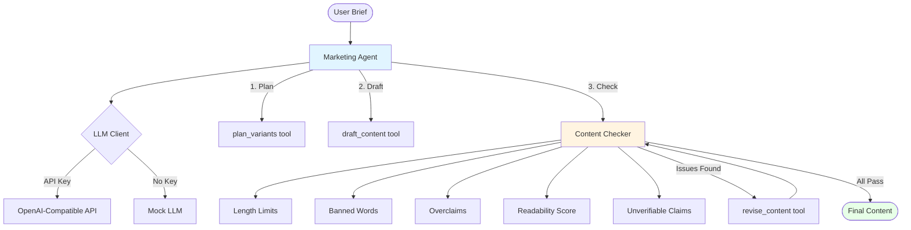

# LLM Marketing Content Agent

A portfolio-quality learning project demonstrating an LLM-powered agent that drafts and validates marketing content for fictional products. The agent uses tool-calling loops to plan content variants, draft copy, run automated checks, and revise based on feedback.

## 🎯 What This Project Demonstrates

- **Tool-calling agent architecture** with planning, execution, and revision loops
- **Deterministic offline testing** with a mock LLM that requires no API key
- **Content validation pipeline** with multiple automated checks
- **Production-ready code quality** with type hints, tests, and clean architecture

## 🏗️ Architecture



### Agent Flow

1. **Planning Phase**: Agent receives a brief (product, audience, channel, tone) and plans 3 content variants with different angles
2. **Drafting Phase**: For each variant, the agent drafts marketing copy
3. **Validation Phase**: Each draft runs through automated checks:
   - **Length limits**: Enforces channel-specific character limits (Twitter: 280, Instagram: 2200, etc.)
   - **Banned words**: Detects problematic marketing language ("guaranteed", "miracle", "risk-free", etc.)
   - **Overclaims**: Flags absolute/unqualified claims ("best", "always", "100%", "never")
   - **Readability**: Measures Flesch Reading Ease and Flesch-Kincaid Grade Level
   - **Unverifiable claims**: Checks for advertising claims that can't be substantiated
4. **Revision Phase**: If checks fail, agent revises content and re-checks
5. **Completion**: Loop continues until all variants pass or max iterations reached

## 🚀 Quick Start

### Installation

```bash
# Clone the repository
git clone https://github.com/shaonsaleh/llm-marketing-agent.git
cd llm-marketing-agent

# Create virtual environment
python -m venv venv
source venv/bin/activate  # On Windows: venv\Scripts\activate

# Install dependencies
pip install -r requirements.txt
```

### Running with Mock LLM (No API Key Required)

The project includes a deterministic mock LLM for testing and demonstration:

```bash
# Run with example brief
python -m src.cli --brief examples/water_bottle_brief.json

# Run with inline parameters
python -m src.cli \
  --product "EcoFlow Reusable Water Bottle - fictional sustainable bottle" \
  --audience "Environmentally conscious millennials" \
  --channel "instagram" \
  --tone "inspiring"

# Verbose mode shows agent's tool calls
python -m src.cli --brief examples/water_bottle_brief.json --verbose
```

### Running with Real LLM (Optional)

```bash
# Copy environment template
cp .env.example .env

# Edit .env and add your API key:
# OPENAI_API_KEY=your-key-here
# OPENAI_BASE_URL=https://api.openai.com/v1
# OPENAI_MODEL=gpt-4o-mini

# Run with API key
python -m src.cli --brief examples/water_bottle_brief.json
```

## 📊 Sample Output

```
🚀 Running agent...

================================================================================
MARKETING CONTENT GENERATION RESULTS
================================================================================

📋 BRIEF:
  Product: EcoFlow Reusable Water Bottle - A fictional premium insulated water bottle...
  Audience: Environmentally conscious millennials and Gen Z, ages 18-35...
  Channel: instagram
  Tone: inspiring and authentic

📊 VARIANTS PLANNED: 3
  • v1: eco-friendly focus (inspiring)
  • v2: cost savings (practical)
  • v3: style and design (trendy)

✍️  DRAFTS:

  [v1]
  Content: Save the planet one sip at a time! Our sleek reusable bottles keep drinks 
  cold for 24hrs. Join the zero-waste movement today! 🌍💧
  Status: ❌ FAILED
  Issues:
    - overclaims: {'found': ['zero'], 'passed': False}

  [v2]
  Content: Stop wasting money on disposable bottles! Our premium reusable bottle pays 
  for itself in just 2 weeks. Smart choice for your wallet & the planet. 💰
  Status: ✅ PASSED

  [v3]
  Content: Hydration meets high fashion! Trending designs that turn heads while keeping 
  drinks at the perfect temp. Your new must-have accessory! ✨
  Status: ✅ PASSED

🔄 REVISIONS:

  [v1]
  Content: Save the planet one sip at a time! Our sleek reusable bottles keep drinks 
  cold for 24hrs. Join the movement today! 🌍💧
  Changes: Removed absolute claim 'zero-waste'
  Status: ✅ PASSED

🔢 Total iterations: 7
================================================================================
```

## 🧪 Running Tests

```bash
# Run all tests
pytest

# Run with coverage
pytest --cov=src --cov-report=html

# Run specific test file
pytest tests/test_agent.py -v
```

### Test Coverage

- **test_content_checks.py**: Validates all content checking logic
- **test_llm_client.py**: Tests mock and real LLM client behavior
- **test_agent.py**: End-to-end agent execution tests

## 📁 Project Structure

```
llm-marketing-agent/
├── src/
│   ├── __init__.py
│   ├── agent.py              # Main agent with tool-calling loop
│   ├── llm_client.py          # LLM client (OpenAI + Mock)
│   ├── content_checks.py      # Content validation rules
│   ├── tools.py               # Tool definitions for LLM
│   └── cli.py                 # Command-line interface
├── tests/
│   ├── test_agent.py
│   ├── test_llm_client.py
│   └── test_content_checks.py
├── examples/
│   ├── water_bottle_brief.json
│   ├── fitness_app_brief.json
│   └── coffee_brand_brief.json
├── requirements.txt
├── .env.example
├── .gitignore
├── LICENSE
└── README.md
```

## 🔍 How Content Checks Work

### 1. Length Limits
Channel-specific character limits prevent content from being cut off:
- Twitter: 280 characters
- Instagram: 2,200 characters
- Facebook: 63,206 characters
- LinkedIn: 3,000 characters
- TikTok: 2,200 characters
- Ad Copy: 150 characters

### 2. Banned Words
Flags problematic marketing terms that often violate platform policies or advertising standards:
- Absolute guarantees: "guaranteed", "risk-free"
- Medical claims: "cure", "miracle", "doctor recommended"
- Scam indicators: "free money", "get rich quick"
- Pressure tactics: "act now", "limited time only"

### 3. Overclaims Detection
Uses regex patterns to detect unqualified superlatives and absolutes:
- Superlatives: "best", "#1", "top", "ultimate", "perfect"
- Absolutes: "always", "never", "everyone", "100%", "zero"
- Hype words: "revolutionary", "breakthrough", "amazing"

### 4. Readability Scores
Uses textstat library to calculate:
- **Flesch Reading Ease**: Measures how easy text is to read (60+ recommended)
- **Flesch-Kincaid Grade**: Estimates U.S. grade level needed (≤10 recommended)

### 5. Unverifiable Claims
Checks for advertising claims that require substantiation:
- Comparative superiority ("best", "top") without proof
- Universal claims ("everyone loves") without data
- Absolute promises ("guaranteed to work") without evidence

## 🎓 What I Learned

### Technical Skills
- **LLM Tool Calling**: Implemented a complete tool-calling loop with function definitions, argument parsing, and result handling
- **Agent Architecture**: Designed a stateful agent that maintains context across multiple iterations
- **Test-Driven Development**: Built comprehensive test coverage including mock implementations
- **API Abstraction**: Created a client that works with real OpenAI API and offline mocks

### Design Patterns
- **Strategy Pattern**: Checker modules are independent and composable
- **Factory Pattern**: LLM client decides between real/mock implementations
- **Command Pattern**: Tool calls encapsulate operations with validation

### Marketing & Compliance
- **Advertising Standards**: Researched FTC guidelines on unverifiable claims and substantiation requirements
- **Platform Policies**: Learned channel-specific content limits and prohibited terms
- **Readability Metrics**: Applied established formulas (Flesch-Kincaid) for content accessibility

### Software Engineering
- **Separation of Concerns**: Clean boundaries between LLM client, agent logic, and validation
- **Dependency Injection**: Agent accepts LLM client, making it testable and flexible
- **Configuration Management**: Environment-based config with sensible defaults
- **Error Handling**: Graceful degradation and informative error messages

## 🚧 Known Limitations

1. **Mock LLM Simplicity**: The mock generates predetermined responses based on simple pattern matching. Real LLM behavior is more nuanced.

2. **Single Language**: Only supports English content. Readability metrics and banned-word lists are English-specific.

3. **Rule-Based Checks**: Validation uses pattern matching and word lists, which can have false positives/negatives. More sophisticated NLP could improve accuracy.

4. **No Tone/Brand Voice Validation**: Checks focus on compliance and technical constraints, not subjective quality or brand alignment.

5. **Sequential Processing**: Variants are processed one at a time. Could be parallelized for better performance.

6. **Limited Revision Strategy**: Agent attempts one revision per failed draft. More sophisticated retry logic could improve results.

7. **No A/B Testing Metrics**: Doesn't predict which variant will perform best with the target audience.

## 🤝 Use Case

This is an **unpaid, non-commercial learning project** created to demonstrate LLM agent development skills. All product examples are **fictional** and for demonstration purposes only.

This project is ideal for:
- Learning how to build LLM agents with tool calling
- Understanding content validation pipelines
- Studying agent architecture patterns
- Portfolio demonstration of Python and AI engineering skills

## 📜 License

MIT License - see LICENSE file for details

## 🔮 Future Enhancements

Potential improvements for learning:
- Multi-language support with language-specific checks
- Image generation for social media posts
- Sentiment analysis for tone validation
- Performance prediction using engagement metrics
- A/B test variant comparison
- Brand voice consistency checking
- Real-time platform API integration (posting to test accounts)
- Web UI for non-technical users

## 📧 Contact

Created as a portfolio learning project. For questions or feedback, open an issue on GitHub.

---

**Note**: This agent generates content for fictional products only. Always review generated content before publishing and ensure compliance with relevant advertising standards and platform policies.
